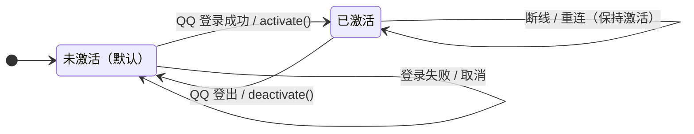

# qq_send_media 技术方案

基于 [`doc/research.md`](./research.md) 的调研结论，本文给出 `qq_send_media` 的落地设计。

**最终决策：只在工具描述和 `promptGuidelines` 里说明调用时机，不做入站文本解析，不做二次确认。** 关键词/正则无法覆盖任意语言；二次确认会阻塞 run、增加状态机和配额复杂度，对单用户个人机器人收益不大。

另外两个已确认的边界：

- **工具只在 QQ 登录成功后激活；登出后停用**。启动 pi 时默认未激活，未登录时模型看不到它。
- **出站文件不限制路径根目录**：任意普通文件都可以发送，只拒绝符号链接、目录、设备等非普通文件。

## 1. 怎么监听 QQ 入站文本？

**不监听，也不解析。**

QQ 消息到达 pi-qq 后，`createInboundHandler()` 会把它整理成 `promptText`，通过 `pi.sendUserMessage()` 交给 pi（`src/qq/qq-message-handler.ts:157`）。模型在同一个 run 里读到用户原话，它本身就是多语言、上下文相关的意图解释器。

因此：

- 不需要 `pi.on("input")` 再解析一遍。
- 不需要维护中英文关键词表。
- 不需要意图识别激活状态机；只需要在 QQ 登录成功/登出时激活/停用工具。
- 不需要确认回复、pending 状态、超时清理。
- 模型看到工具描述后，根据用户原话决定是否调用。

代价是：“不自动调用”是**模型行为约束**，不是机制保证。描述写得足够明确可以显著降低误调用，但不能 100% 保证。这个取舍已确认接受；如果以后发现误调用频繁，再考虑其他机制。

## 2. 行为契约

| 场景                       | 行为                               |
| -------------------------- | ---------------------------------- |
| 用户说“生成一张图片”       | 模型应只返回本地路径，不调用工具   |
| 用户说“把截图发给我”       | 模型调用工具，媒体发送到 QQ        |
| 用户用任何语言表达回传意图 | 由模型理解；工具描述不依赖具体语言 |
| 用户说“别发了”             | 已发送的无法撤回；模型不应再调用   |
| 请求模糊                   | 模型应先问用户，而不是直接调用     |
| 工具被调用                 | 产生普通工具气泡，并发送媒体消息   |
| 启动 pi / 未登录           | 默认未激活，模型看不到工具         |
| QQ 登录成功                | 工具激活；调用时机仍由模型判断     |
| QQ 登出                    | 工具停用                           |

工具气泡与其它工具完全一致：`## 📤 qq_send_media` + 正常的参数/结果气泡，不做抑制、不做特殊渲染。

## 3. 工具描述与提示词

这是本方案的核心。注册工具时使用：

```ts
description:
  "Send a local image, video, or file to the bound QQ private chat. " +
  "Call only when the user explicitly asks to send media back to QQ. " +
  "If the request is ambiguous, ask the user before calling.",

promptSnippet:
  "Send a local image, video, or file back to the user's QQ chat",

promptGuidelines: [
  "Use qq_send_media only when the user explicitly asks to send an image, video, or file back to QQ.",
  "Never call qq_send_media proactively after generating, editing, or reading a file; report the local path instead.",
  "If you are unsure whether the user wants the file sent to QQ, ask them first; do not call the tool.",
],
```

要点：

- 明确写出“只在用户明确要求时调用”。
- 明确写出“不要因为生成了文件就主动调用”。
- 增加“if unsure, ask”规则，让模型在模糊请求时先问，而不是直接调用。
- 不要在描述里列举“截图/图片/视频”等关键词；模型理解用户语言，不需要关键词表。
- `promptSnippet` 让工具出现在系统提示词的 `<tools>` 段；不填则不会出现在该段。

## 4. 工具定义

### 4.1 参数 schema

```ts
import { Type } from "typebox";
import { StringEnum } from "@earendil-works/pi-ai";

const mediaParams = Type.Object({
  path: Type.String({ description: "Local image/video/file path, absolute or relative to cwd." }),
  kind: Type.Optional(StringEnum(["auto", "image", "video", "file"] as const)),
  caption: Type.Optional(Type.String({ description: "Optional caption shown with the media." })),
  name: Type.Optional(Type.String({ description: "Display filename for kind=file." })),
});
```

默认 `kind = "auto"`。`path` 去掉模型可能带上的前导 `@`，相对路径按 `ctx.cwd` 解析。

**不限制路径根目录**：可以发送 `~/Downloads`、`/tmp` 等任意位置的普通文件；只拒绝符号链接、目录、设备等非普通文件。模型本身已经能通过 `read`/`bash` 读取本机文件，限制路径不是强安全边界。

### 4.2 执行入口

```ts
async execute(toolCallId, params, signal, onUpdate, ctx) {
  const bot = deps.getBot();
  const login = deps.getLogin();
  if (!bot || !login) throw new Error(t("mediaTool.notConnected"));
  if (signal?.aborted) throw new Error("Cancelled");

  const prepared = await prepareMedia(params, ctx.cwd); // 路径、类型、大小校验

  // upload + send（见 §5）
}
```

工具注册为 `defaultActive: false`，QQ 登录成功后激活，登出/停止时停用。不跟随 `connected`/`reconnecting` 状态；登录期间断线重连不改变工具可用性，但 bot 未就绪时 `execute()` 会报错。

### 4.3 登录成功激活，登出停用

`registerMediaTool()` 返回 `activate()` / `deactivate()`：

```ts
activate() {
  const active = pi.getActiveTools();
  if (!active.includes(MEDIA_TOOL_NAME)) {
    pi.setActiveTools([...new Set([...active, MEDIA_TOOL_NAME])]);
  }
}

deactivate() {
  const active = pi.getActiveTools();
  if (active.includes(MEDIA_TOOL_NAME)) {
    pi.setActiveTools(active.filter((name) => name !== MEDIA_TOOL_NAME));
  }
}
```

只有三个场景：

1. **启动 pi**：工具注册为 `defaultActive: false`，默认未激活。
2. **QQ 登录成功**：`startWithCredentials()` 调用 `mediaTool.activate()`。
3. **QQ 登出**：`stopIfRunning()` 调用 `mediaTool.deactivate()`；`/qq-login` 重启 bot、`session_shutdown` 也走这里。

不监听 `onStateChange`：登录后短暂断线/重连时工具保持激活，恢复后可直接使用；bot 未就绪时 `execute()` 报错。

### 4.4 状态流转图



## 5. 发送流程

与 `doc/research.md` §5.2 一致：

```ts
const upload = await bot.uploadMedia({
  target: { scope: "c2c", targetId: login.allowedOpenid },
  fileType: prepared.fileType,
  localPath: prepared.path,
  fileName: prepared.fileType === MediaFileType.FILE ? prepared.displayName : undefined,
  srvSendMsg: false,
  onProgress: (uploaded, total) =>
    onUpdate?.({
      content: [{ type: "text", text: `Uploading ${Math.round((uploaded / total) * 100)}%` }],
      details: { ...prepared.details, phase: "upload", uploaded, total },
    }),
});

const reply = deps.budget.acquire();
const targetId = reply.openid ?? login.allowedOpenid;
const msgId = reply.mode === "passive" ? reply.msgId : undefined;

const message = await bot.mediaApi.sendMediaMessage("c2c", targetId, upload.file_info, bot.getCredentials(), {
  msgId,
  content: params.caption?.slice(0, TEXT_CHUNK_LIMIT),
});

if (msgId) deps.budget.commitPassive(msgId);
```

- 被动发送失败时，复用 `upload.file_info` 主动重试一次，不重新上传。
- 只有被动发送成功才 `commitPassive()`。
- 每次媒体发送消耗一个被动回复名额；连续发多个媒体后，最终文本可能降级主动消息。
- 工具设 `executionMode: "sequential"`。

### 5.1 文件校验

| 检查       | 处理                                    |
| ---------- | --------------------------------------- |
| 路径存在   | `lstat`；`ENOENT` → 报错                |
| 符号链接   | 拒绝（`stat.isSymbolicLink()`）         |
| 非普通文件 | 拒绝目录、设备等                        |
| 空文件     | 拒绝                                    |
| 类型识别   | 扩展名白名单；音频按 `FILE`             |
| 大小       | 按 `getMaxUploadSize(fileType)` 校验    |
| 文件名     | `basename`；`file` 类型可用 `name` 覆盖 |

## 6. 错误处理

| 场景                              | 错误/提示                                                   |
| --------------------------------- | ----------------------------------------------------------- |
| 手动激活但未登录 / bot 未启动     | `mediaTool.notConnected`，提示 `/qq-login`                  |
| 文件不存在                        | 带绝对路径                                                  |
| 符号链接/目录/设备                | `mediaTool.notRegularFile`                                  |
| 空文件                            | `mediaTool.emptyFile`                                       |
| 超过类型上限                      | `mediaTool.tooLarge`，带大小和上限                          |
| `kind=image/video` 但扩展名不匹配 | `mediaTool.unsupportedKind`                                 |
| `UploadDailyLimitExceededError`   | `mediaTool.uploadDailyLimit`，提示改发小文件或明天再试      |
| `ApiError`                        | `mediaTool.apiFailed`，带 `bizCode`/`bizMessage`            |
| 被动发送失败，主动重试成功        | `onWarn(t("outbound.passiveFailed"))`，结果标记 `proactive` |
| 两次都失败                        | 抛错，带最后一次错误                                        |

错误必须通过 `throw` 或 `isError: true` 返回，不能只在 `content` 里描述失败。

## 7. 工具气泡

- 在 `src/relay/stream-block-format.ts` 的 `TOOL_ICONS` 增加 `qq_send_media: "📤"`。
- **不做任何特殊处理**：`RunFeedback` 照常转发 `tool_execution_start` / `tool_execution_end`，气泡形如：

````
## 📤 qq_send_media

`{"path":"output/shot.png","caption":"效果图"}`

```text
Sent image shot.png to QQ (msg-id).
```
````

- 不要注册 `renderCall`/`renderResult`，不要抑制气泡，不要改 `BubbleWriter`。
- 工具结果保持一行，避免在 QQ 上刷屏；媒体本身是单独的消息，和工具气泡并存。

## 8. 模块改动

| 文件                               | 改动                                                                               |
| ---------------------------------- | ---------------------------------------------------------------------------------- |
| `src/qq/media-tool.ts`             | 新增：schema、execute、路径/类型/大小校验、上传发送、激活控制器                    |
| `index.ts`                         | 注册 `defaultActive: false`；`startWithCredentials()` 激活，`stopIfRunning()` 停用 |
| `src/relay/stream-block-format.ts` | `TOOL_ICONS` 增加 `qq_send_media`                                                  |
| `src/infra/i18n.ts`                | 增加 `mediaTool.*` 文案                                                            |
| `test/qq/media-tool.test.ts`       | 新增                                                                               |
| `test/index.test.ts`               | fake pi 增加 `getActiveTools`/`setActiveTools`，验证登录成功/登出激活              |
| `README.md` / `README-zh.md`       | 说明工具用法、登录后激活、调用时机、配额                                           |
| `CHANGELOG.md`                     | Unreleased 条目                                                                    |

不需要改 `src/qq/qq-message-handler.ts`，不需要新增配置项，不需要确认状态机。

## 9. 测试计划

### 9.1 单元测试

- 工具注册为 `defaultActive: false`；启动/未登录时不在 active set。
- QQ 登录成功后工具进入 active set；登出/`stopIfRunning` 后移除。
- 断线/重连不改变 active 状态；登录后工具保持可用。
- 激活/停用只增删 `qq_send_media`，保留其它工具；幂等。
- 描述/提示词包含“only when explicitly asked”“never proactively”“if unsure, ask”。
- 文件校验：不存在、符号链接、目录、空文件、超限、合法文件。
- 类型识别：jpg/png/gif/webp/bmp → image；mp4/mov/... → video；pdf/zip/mp3 → file；显式 `kind` 覆盖。
- 被动发送成功：`uploadMedia` 用 allowlist openid、正确的 `fileType`/`localPath`；`sendMediaMessage` 带 `msgId`；`commitPassive` 调用一次。
- 主动：无目标或窗口过期时，`sendMediaMessage` 不带 `msgId`。
- 被动失败：复用同一个 `file_info` 主动重试，不重复上传，不 `commitPassive`，触发 `onWarn`。
- 上传失败：不再调用 `sendMediaMessage`；`UploadDailyLimitExceededError` 被翻译。
- `caption` 截断到 4500 字符。
- 手动激活但未登录 / bot 未启动时 `execute` 报错；正常路径下未登录时工具不可见。

### 9.2 手工验证

- 用中文、英文、日文、表情混合等不同表述让 pi 发截图，观察是否只在明确要求时调用。
- 生成图片但不说“发给我”，确认工具没有被调用（查日志/工具列表）。
- 工具气泡正常显示，媒体消息与气泡并存。
- 连续发 4 个媒体，观察最终文本是否降级主动消息。
- 大文件、无权限、断线等错误。
- 启动 pi 未登录时工具不可见；登录成功后可见；登出后不可见。
- 登录后断线/重连期间工具仍可见。
- 被动窗口过期后调用，确认走主动消息。

## 10. 风险与开放问题

1. **描述约束是软约束**：模型可能误判、误调用。描述和提示词能降低概率，但不能消除。已接受这个取舍。
2. **没有硬门禁**：如果模型无视描述，工具仍可能被调用并发送。后续如果误调用频繁，再考虑发送前确认或其他机制；v1 不做。
3. **多语言覆盖**：由模型理解，不依赖关键词；但模型对某些小语种/俚语的理解仍可能出错，需要真实语料验证。
4. **工具可发现性**：登录后工具在提示词里，可能诱导模型调用。`promptGuidelines` 必须明确写“不要主动调用”，并通过真实语料观察。
5. **登录期间断线**：工具保持激活，但 bot 未就绪时 `execute()` 会报错；恢复后可直接使用。
6. **路径不限制**：可以发送任意普通文件。模型本身已能读取本机文件，限制路径不是强安全边界；只做了符号链接/非普通文件校验。
7. **配额与顺序**：媒体消息和最终文本共享被动回复预算；连续发送可能让最终文本降级。需要实测。
8. **工具气泡与媒体顺序**：工具开始会先推送气泡头，媒体在 execute 中发送，结果在工具结束后推送；实际到达顺序受流式节流影响，需实测。

## 11. 实施顺序

1. `media-tool.ts`：schema、校验、上传/发送、激活控制器。
2. 工具描述与 `promptGuidelines`。
3. `index.ts` 注册（`defaultActive: false`）+ `startWithCredentials()` 激活 / `stopIfRunning()` 停用 + 依赖注入。
4. `TOOL_ICONS`、i18n、README、CHANGELOG。
5. 真机验证：启动未激活、登录后激活、登出停用、重连保持激活、多语言请求、非请求不调用、工具气泡、配额、大小限制。

## 12. 参考

| 主题                        | 位置                                                        |
| --------------------------- | ----------------------------------------------------------- |
| pi 自定义工具与提示词       | `pi/packages/coding-agent/docs/extensions.md:2180`          |
| 工具描述/`promptGuidelines` | `pi/packages/coding-agent/docs/extensions.md:2184`          |
| 工具结果结构                | `pi/packages/agent/src/types.ts:424`                        |
| pi-qq 入站处理              | `src/qq/qq-message-handler.ts:28`                           |
| pi-qq 文本发送/预算         | `src/qq/reply-sender.ts:111`、`src/quota/reply-quota.ts:24` |
| pi-qq 工具气泡              | `src/relay/stream-block-format.ts:10`、`:105`               |
| QQ 媒体发送细节             | `doc/research.md` §3、§5                                    |
